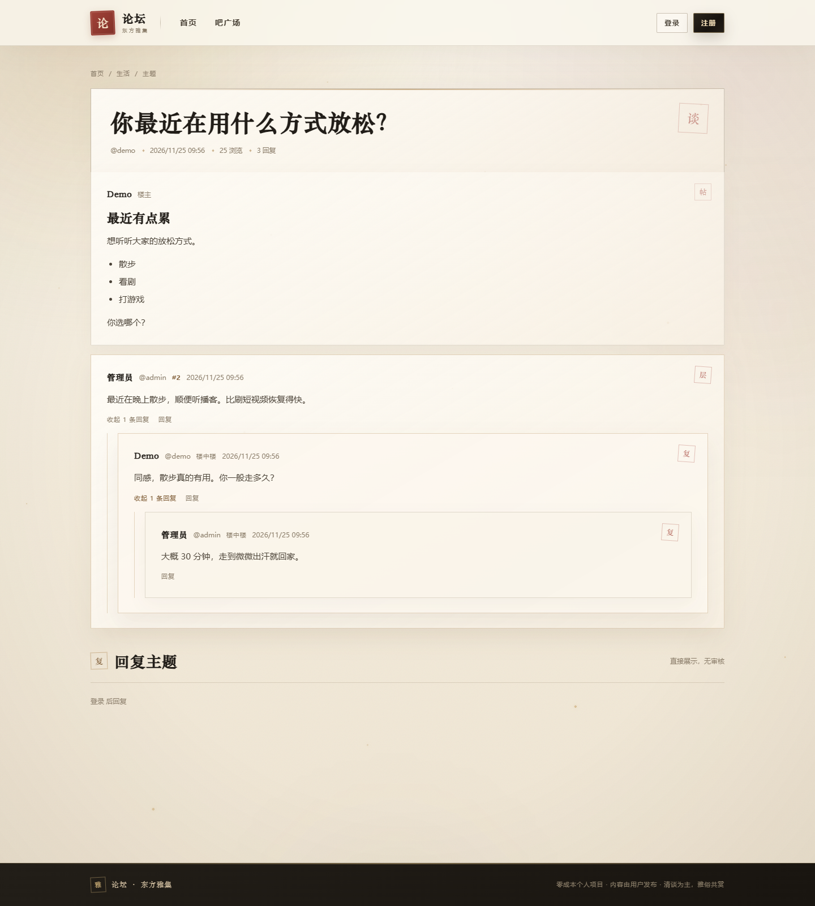
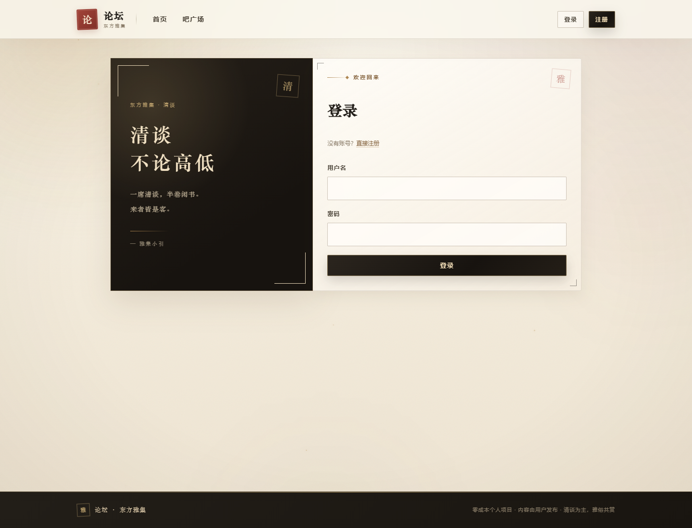
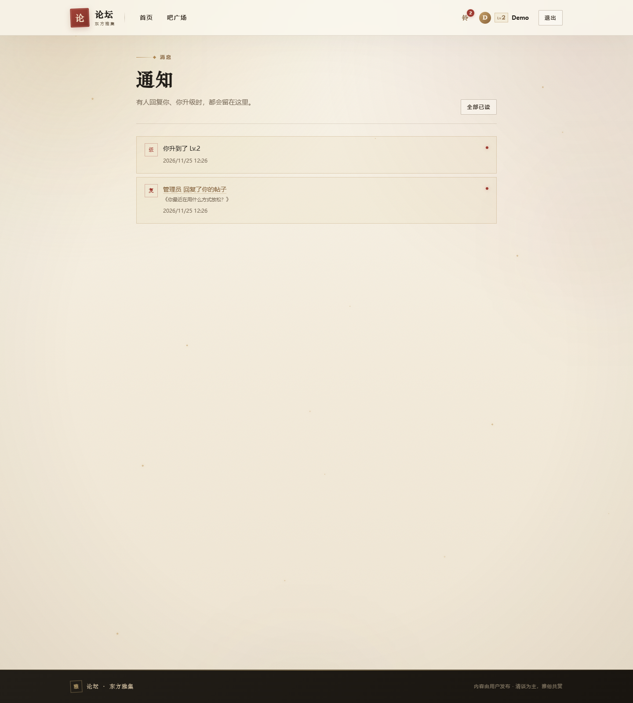
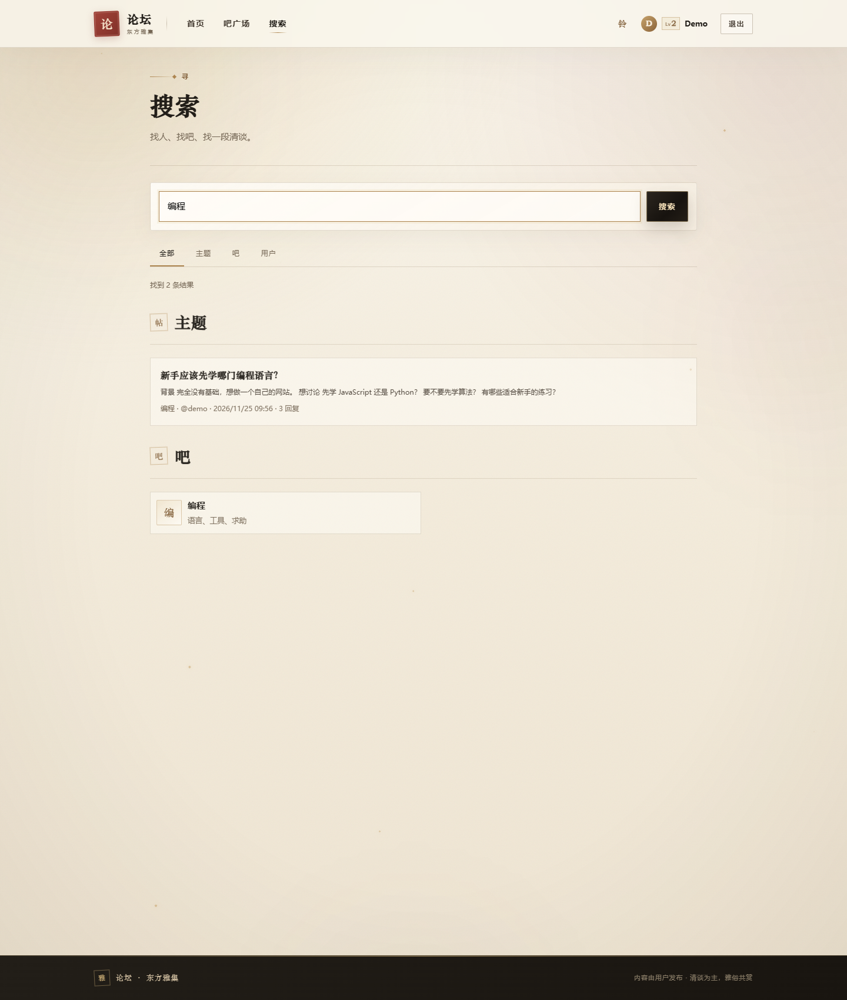
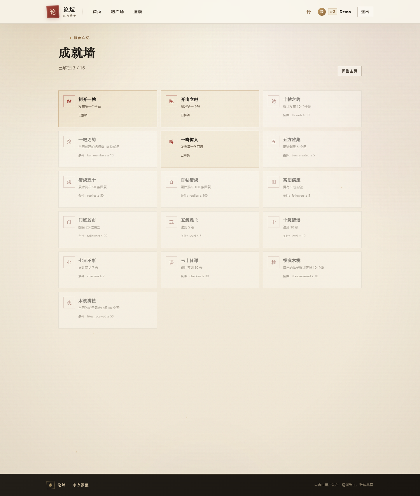
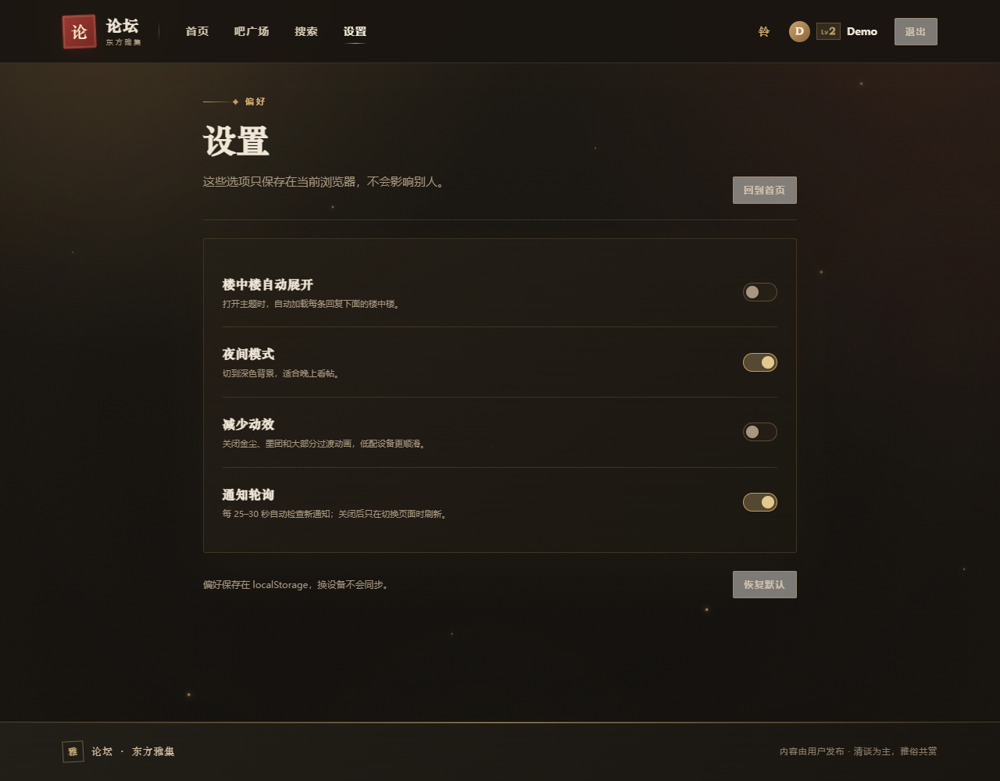

# 论坛 MVP

一个贴吧式的综合讨论社区：吧、主题、楼层、无限楼中楼、开放注册、无发帖前审核。

视觉方向：**象牙白 + 古铜金 · 东方雅致 · 衬线标题 + 无衬线正文 · 强氛围动效**。  
用宣纸底、墨色、印章、金线、噪点与缓慢漂浮的金尘，做“华丽但克制”的东方编辑感。

- 前端：Vite + React + TypeScript + HashRouter
- 后端：Fastify + Drizzle ORM + MySQL 8.4
- 部署：GitHub Pages（静态前端）+ 当前电脑 API + ngrok 免费 dev domain
















---

## 当前地址

| 用途 | 地址 |
|---|---|
| 公网前端 | <https://berlin-blog.github.io/forum/> |
| GitHub 仓库 | <https://github.com/Berlin-blog/forum> |
| 本地前端 | <http://127.0.0.1:5173/> |
| 本地 API | <http://127.0.0.1:3002/api/health> |
| 公网 API | <https://promotion-surpass-jazz.ngrok-free.dev/api/health> |

> 公网 API 是 ngrok 免费隧道；浏览器直接打开可能先看到 ngrok 警告页。前端请求会带 `ngrok-skip-browser-warning: 1` 绕过。

---

## 本地启动

### 1. 启动项目 MySQL

```powershell
D:\code\work\forum\scripts\start-mysql.ps1
```

项目使用独立的 MySQL 实例：

- 端口：`3307`
- 数据目录：`forum/data/mysql`
- 数据库：`forum`
- 用户：`forum` / `forum_dev_password`

不碰系统原有的 `MySQL84` 服务（它占用 3306，并且被另一个任务排期应用使用）。

### 2. 安装依赖

```powershell
cd D:\code\work\forum
pnpm install
```

### 3. 初始化数据库

```powershell
pnpm --filter api db:migrate
```

已有用户升级后，可补一次称号 / 成就同步：

```powershell
pnpm --filter api db:sync-growth
```

首次使用热点机器人时创建账户：

```powershell
pnpm --filter api db:seed-bot
```

机器人每 2 小时最多发 1 条，服务启动后自动运行；手动跑一次：

```powershell
pnpm --filter api bot:run
```

手动结算上一周：

```powershell
pnpm --filter api weekly:settle
```

### 4. 启动 API

```powershell
pnpm --filter api start
```

API 监听 `127.0.0.1:3002`。

### 5. 启动前端

```powershell
pnpm --filter web dev --host 127.0.0.1
```

打开 <http://127.0.0.1:5173/>。

### 6. 启动 ngrok

```powershell
D:\code\work\forum\scripts\start-ngrok.ps1
```

或手动：

```powershell
ngrok http 3002 --url https://promotion-surpass-jazz.ngrok-free.dev
```

前端 API 地址在 [apps/web/public/config.js](apps/web/public/config.js)。

---

## 目录

```
forum/
├── apps/
│   ├── api/                 # Fastify + MySQL
│   │   ├── migrations/      # 0001_init.sql / 0002_social_growth.sql
│   │   └── src/
│   │       ├── routes/      # auth / bars / threads / posts / users / me / notifications
│   │       ├── db/          # schema / client / migrate
│   │       └── lib/         # auth / guard / content / progression
│   └── web/                 # Vite + React
│       ├── public/config.js # 运行时 API 地址
│       └── src/
│           ├── pages/       # 首页 / 吧 / 主题 / 登录 / 注册
│           └── components/  # Layout / PostNode / ReplyForm
├── scripts/                 # 启停脚本
├── docs/                    # 方案与截图
└── pnpm-workspace.yaml
```

---

## 已实现

- 用户名 + 密码注册 / 登录 / 退出
- Bearer token 会话（数据库存 SHA-256 哈希）
- 吧列表、分类、吧主页
- **用户创建吧**：创建者自动成为吧主
- 关注 / 取消关注吧
- 发主题、主题列表、主题详情
- **分页 / 加载更多**：主题、楼层、楼中楼、搜索
- **编辑 / 删除自己的主题和回复**
- **自动草稿**：发主题与回复本地自动保存、刷新恢复
- **图文发帖 / 图片回复**：图片压缩为 WebP，8MB 内
- 顶层回复
- **无限层楼中楼**：`parent_id` 自关联，前端逐层展开
- 点赞帖子
- **搜索**：吧 / 主题 / 用户，匹配标题、首楼和所有回复
- **个人主页**：等级、称号、粉丝/关注、关注的吧、主题、回复、成就
- **关注用户 / 粉丝**：粉丝 / 关注列表弹层，可直接关注/取关
- **通知中心**：被回复、升级、被关注；点击单条即标记已读，25–30 秒轮询刷新
- **1–20 级经验系统**：发帖、回复、被回复、签到获取经验，每日上限已提高
- **签到**：每日一次
- **称号**：46 个称号，等级解锁 + 行为条件解锁 + 周榜限时称号，可佩戴 / 卸下
- **称号墙**：查看全部称号与解锁条件
- **成就**：16 个成就，独立成就墙
- **等级榜**：按等级与经验排序；demo、管理员、机器人不参与排名
- **本周榜**：按当周经验排序，每周一结算
- **每周限时称号**：周榜前三获得 7 天称号
- **热点机器人**：每 2 小时最多自动发 1 条热点，自动匹配吧，去重
- **每日任务**：签到、发帖、回复、收到回复四个进度
- **设置页**：楼中楼自动展开、夜间模式、减少动效、通知轮询开关
- **吧主后台**：吧规、小吧主、成员管理
- 管理员事后处理接口（举报、封禁、隐藏主题 / 帖子）
- Markdown 渲染 + HTML 清洗
- GitHub Pages 部署 workflow

## 首页与性能

- 首页改为杂志式编辑布局：精选、正在发生、游园、等级榜、今日课业、签到
- 首页只请求一个聚合接口 `/api/home`，不再串行请求吧列表 + 主题 + 任务
- 减少粒子数量、移除 reveal 的模糊滤镜、移动端关闭金尘并启用 `content-visibility`
- 图片上传后压缩为 WebP 并内嵌到内容，避免 ngrok 免费版插页挡住图片；原文件同时保存在 `uploads/`
- 手机端适配：设置、周榜、称号墙、吧主后台都做了响应式，导航在小屏收成单字入口

## 成长系统

| 行为 | 经验 | 每日上限 |
|---|---:|---:|
| 发主题 | +8 | 40 |
| 发回复 / 楼中楼 | +5 | 40 |
| 被回复 | +3 | 30 |
| 签到 | +8 | 8 |

等级门槛（累计经验）：

| 等级 | 累计经验 |
|---|---:|
| L1 → L2 | 10 |
| L2 → L3 | 110 |
| L3 → L4 | 310 |
| L4 → L5 | 660 |
| L5 → L6 | 1,160 |
| L10 | 4,660 |
| L15 | 12,410 |
| L20 | 23,910 |

称号按等级自动解锁，包含古典称号与新趣味称号：初入雅集、扫花人、煮茶客、问茶客、听雨人、观云者、藏书家、藏锋、知味、山中宰相、半隐、雅集主人、摘星、清谈传奇；以及新席客、气氛组组长、深夜茶客、课代表、人间观察员、赛博隐士、考古学家、楼中楼建筑师、电子包浆、赛博说书人、人间清醒、赛博陶渊明、互联网嘴替、键盘侠克星、电子古董、赛博菩萨、清谈区UP主、时间管理大师、人间值得、赛博庄子。

额外还有 9 个行为条件称号：开吧元老、一吧之主、百帖斩、楼中楼之王、万人迷、点赞收割机、签到仙人、标题制造机、深夜不睡。称号墙 `/titles` 可查看全部与解锁条件。

每周结算还会给本周经验榜前三名发放 7 天限时称号：本周魁首、本周亚席、本周季席。demo、管理员、热点机器人不参与排行榜，也不会获得周榜称号。

## 热点机器人与周榜

- 机器人账户：`hotbot` / 显示名「热点播报」
- 数据源：百度热搜公开页面；按关键词匹配到对应吧
- 每 2 小时最多发 **1 条**，服务重启也会读取上次发帖时间，不重复轰炸
- `hot_topic_posts.fingerprint` 唯一索引去重，同一热点不会重复发
- demo、管理员、热点机器人从等级榜 / 周榜中排除
- 每周结算上一周经验榜，前三名获得 7 天限时称号
- 限时称号过期后自动从主页和称号墙消失

## 未实现

- 举报 / 审核后台 UI
- 吧主后台 UI
- 邮箱 / 找回密码
- 完整管理后台页面
- 图片内容审核
- 会员 / 广告 / 支付

---

## 关键接口

| 方法 | 路径 | 说明 |
|---|---|---|
| `GET` | `/api/health` | 健康检查 |
| `GET` | `/api/home` | 首页聚合（吧、精选、最新、榜单、任务） |
| `GET` | `/api/search?q=&type=` | 搜索吧 / 主题 / 用户 |
| `POST` | `/api/uploads` | 上传图片（8MB 内） |
| `POST` | `/api/auth/register` | 注册 |
| `POST` | `/api/auth/login` | 登录 |
| `POST` | `/api/auth/logout` | 退出 |
| `GET` | `/api/me` | 当前用户 |
| `GET` | `/api/bars` | 分类 + 吧 |
| `POST` | `/api/bars` | 用户创建吧 |
| `GET` | `/api/bars/:slug` | 吧详情 / 是否关注 / 是否可管理 |
| `PATCH` | `/api/bars/:slug` | 修改吧资料与吧规 |
| `GET` | `/api/bars/:slug/manage` | 吧主后台数据 |
| `POST` | `/api/bars/:slug/moderators` | 任命小吧主 |
| `DELETE` | `/api/bars/:slug/moderators/:userId` | 移除小吧主 |
| `DELETE` | `/api/bars/:slug/members/:userId` | 移出成员 |
| `POST` | `/api/bars/:slug/follow` | 关注 / 取消关注吧 |
| `GET` | `/api/me/bars` | 我关注的吧 |
| `GET` | `/api/threads?bar=&limit=&offset=` | 主题列表 |
| `POST` | `/api/threads` | 发主题 |
| `PATCH` | `/api/threads/:id` | 编辑自己的主题 |
| `DELETE` | `/api/threads/:id` | 删除自己的主题 |
| `GET` | `/api/threads/:id` | 主题 + 首楼 |
| `GET` | `/api/threads/:id/posts` | 顶层楼层（分页） |
| `POST` | `/api/threads/:id/posts` | 顶层回复 |
| `GET` | `/api/posts/:id/children` | 直接子回复（分页） |
| `POST` | `/api/posts/:id/replies` | 楼中楼回复（不限层级） |
| `PATCH` | `/api/posts/:id` | 编辑自己的回复 |
| `DELETE` | `/api/posts/:id` | 删除自己的回复 |
| `POST` | `/api/posts/:id/like` | 点赞 / 取消 |
| `POST` | `/api/checkin` | 每日签到 |
| `GET` | `/api/me/checkin` | 今日签到状态 |
| `GET` | `/api/me/titles` | 我的称号 |
| `GET` | `/api/titles` | 称号图鉴（含解锁状态） |
| `POST` | `/api/me/title` | 佩戴 / 卸下称号 |
| `PATCH` | `/api/me` | 修改资料 |
| `GET` | `/api/notifications` | 通知列表 |
| `GET` | `/api/notifications/unread-count` | 未读数 |
| `POST` | `/api/notifications/read` | 全部已读 |
| `POST` | `/api/notifications/:id/read` | 单条已读 |
| `GET` | `/api/me/daily-tasks` | 每日任务 |
| `GET` | `/api/leaderboard` | 等级榜 |
| `GET` | `/api/leaderboard/weekly` | 本周经验榜 |
| `GET` | `/api/achievements` | 成就墙（含解锁状态） |
| `POST` | `/api/reports` | 提交举报 |
| `GET` | `/api/admin/reports` | 管理员：举报列表 |
| `POST` | `/api/admin/reports/:id/resolve` | 管理员：处理举报 |
| `POST` | `/api/admin/users/:id/sanction` | 管理员：封禁 / 解封 |
| `POST` | `/api/admin/threads/:id/hide` | 管理员：隐藏 / 恢复主题 |
| `POST` | `/api/admin/posts/:id/hide` | 管理员：隐藏 / 恢复帖子 |
| `GET` | `/api/users/:username` | 用户主页（统计 / 关注吧 / 主题 / 回复 / 称号 / 成就） |
| `GET` | `/api/users/:username/followers` | 粉丝列表 |
| `GET` | `/api/users/:username/following` | 关注列表 |
| `POST` | `/api/users/:username/follow` | 关注 / 取消关注用户 |

认证：

```http
Authorization: Bearer <token>
```

---

## 数据库

- MySQL 8.4，`utf8mb4_0900_ai_ci`
- 主键 `BIGINT UNSIGNED AUTO_INCREMENT`
- `posts.parent_id` 自关联，无 `depth` 限制
- 顶层楼层 `floor` 唯一；楼中楼 `floor = NULL`
- `threads` / `posts` 有 FULLTEXT ngram 索引
- 迁移文件：[0001_init.sql](apps/api/migrations/0001_init.sql)、[0002_social_growth.sql](apps/api/migrations/0002_social_growth.sql)、[0003_more_growth.sql](apps/api/migrations/0003_more_growth.sql)、[0004_attachments.sql](apps/api/migrations/0004_attachments.sql)、[0005_more_titles.sql](apps/api/migrations/0005_more_titles.sql)、[0006_conditional_titles.sql](apps/api/migrations/0006_conditional_titles.sql)、[0007_bot_and_weekly.sql](apps/api/migrations/0007_bot_and_weekly.sql)、[0008_bot_role.sql](apps/api/migrations/0008_bot_role.sql)

---

## GitHub Pages

已上线：<https://berlin-blog.github.io/forum/>

仓库包含：

- [.github/workflows/deploy-web.yml](.github/workflows/deploy-web.yml)（build + deploy 两个 job）
- [.github/workflows/api-ci.yml](.github/workflows/api-ci.yml)

更新流程：

1. push `main`
2. GitHub Actions 构建 `apps/web`
3. 自动部署到 Pages
4. API 和 MySQL 仍然跑在当前电脑

---

## 管理员

- 已创建 `admin` 账号；初始强密码在交付消息里，没有写进仓库
- 重置密码：

```powershell
D:\code\work\forum\scripts\reset-admin-password.ps1
```

- 管理接口：举报列表、处理举报、封禁 / 解封用户、隐藏 / 恢复主题和帖子

---

## 安全提醒

- `.env` 已加入 `.gitignore`，不要提交
- ngrok authtoken 只保存在本机 `ngrok.yml`
- 管理后台、举报、封禁 UI 还没接；目前公开站点请勿存放敏感内容
- 无发帖限制、无发帖前审核，垃圾内容需要管理员事后清理
- 生产使用前请换掉 `forum_dev_password` 并配置强密码

---

## 文档

- [建设方案 v1.3](docs/forum-plan.md)
- [项目评估与优化路线](docs/project-review.md)
- [ngrok 配置指南](docs/ngrok-setup.md)
- [v1.2 存档](docs/archive/forum-plan-v1.2.md)
