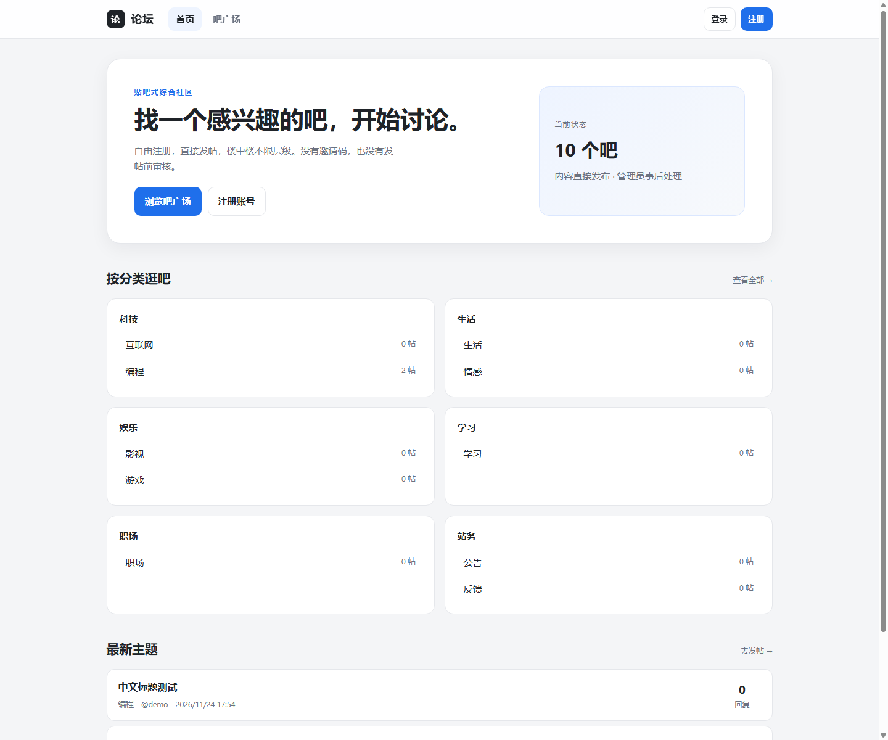

# 论坛 MVP

一个贴吧式的综合讨论社区：吧、主题、楼层、无限楼中楼、开放注册、无发帖前审核。

- 前端：Vite + React + TypeScript + HashRouter
- 后端：Fastify + Drizzle ORM + MySQL 8.4
- 部署：GitHub Pages（静态前端）+ 当前电脑 API + ngrok 免费 dev domain




---

## 当前地址

| 用途 | 地址 |
|---|---|
| 本地前端 | <http://127.0.0.1:5173/> |
| 本地 API | <http://127.0.0.1:3002/api/health> |
| 公网 API | <https://promotion-surpass-jazz.ngrok-free.dev/api/health> |
| GitHub Pages | 推送到 GitHub 后，在仓库 Settings → Pages 选择 GitHub Actions |

> 公网 API 是 ngrok 免费隧道；浏览器直接打开可能先看到 ngrok 警告页。前端请求会带 `ngrok-skip-browser-warning: 1` 绕过。

---

## 本地启动

### 1. 启动项目 MySQL

```powershell
D:\code\work\forum\scripts\start-mysql.ps1
```

项目使用独立的 MySQL 实例：

- 端口：`3307`
- 数据目录：`forum/data/mysql`
- 数据库：`forum`
- 用户：`forum` / `forum_dev_password`

不碰系统原有的 `MySQL84` 服务（它占用 3306，并且被另一个任务排期应用使用）。

### 2. 安装依赖

```powershell
cd D:\code\work\forum
pnpm install
```

### 3. 初始化数据库

```powershell
pnpm --filter api db:migrate
```

### 4. 启动 API

```powershell
pnpm --filter api start
```

API 监听 `127.0.0.1:3002`。

### 5. 启动前端

```powershell
pnpm --filter web dev --host 127.0.0.1
```

打开 <http://127.0.0.1:5173/>。

### 6. 启动 ngrok

```powershell
D:\code\work\forum\scripts\start-ngrok.ps1
```

或手动：

```powershell
ngrok http 3002 --url https://promotion-surpass-jazz.ngrok-free.dev
```

前端 API 地址在 [apps/web/public/config.js](apps/web/public/config.js)。

---

## 目录

```
forum/
├── apps/
│   ├── api/                 # Fastify + MySQL
│   │   ├── migrations/      # 0001_init.sql
│   │   └── src/
│   │       ├── routes/      # auth / bars / threads / posts / users
│   │       ├── db/          # schema / client / migrate
│   │       └── lib/         # auth / guard / content
│   └── web/                 # Vite + React
│       ├── public/config.js # 运行时 API 地址
│       └── src/
│           ├── pages/       # 首页 / 吧 / 主题 / 登录 / 注册
│           └── components/  # Layout / PostNode / ReplyForm
├── scripts/                 # 启停脚本
├── docs/                    # 方案与截图
└── pnpm-workspace.yaml
```

---

## 已实现

- 用户名 + 密码注册 / 登录 / 退出
- Bearer token 会话（数据库存 SHA-256 哈希）
- 吧列表、分类、吧主页
- 发主题、主题列表、主题详情
- 顶层回复
- **无限层楼中楼**：`parent_id` 自关联，前端逐层展开
- 点赞帖子
- 个人主页
- 管理员事后处理接口（举报、封禁、隐藏主题 / 帖子）
- Markdown 渲染 + HTML 清洗
- 中文 FULLTEXT ngram 搜索索引（API 搜索接口待接）
- GitHub Pages 部署 workflow

## 未实现

- 图片上传
- 站内通知 UI
- 举报 / 审核后台 UI
- 搜索页面
- 用户创建吧
- 邮箱 / 找回密码
- 管理后台页面

---

## 关键接口

| 方法 | 路径 | 说明 |
|---|---|---|
| `GET` | `/api/health` | 健康检查 |
| `POST` | `/api/auth/register` | 注册 |
| `POST` | `/api/auth/login` | 登录 |
| `POST` | `/api/auth/logout` | 退出 |
| `GET` | `/api/me` | 当前用户 |
| `GET` | `/api/bars` | 分类 + 吧 |
| `GET` | `/api/bars/:slug` | 吧详情 |
| `GET` | `/api/threads?bar=&limit=&offset=` | 主题列表 |
| `POST` | `/api/threads` | 发主题 |
| `GET` | `/api/threads/:id` | 主题 + 首楼 |
| `GET` | `/api/threads/:id/posts` | 顶层楼层 |
| `POST` | `/api/threads/:id/posts` | 顶层回复 |
| `GET` | `/api/posts/:id/children` | 直接子回复 |
| `POST` | `/api/posts/:id/replies` | 楼中楼回复（不限层级） |
| `POST` | `/api/posts/:id/like` | 点赞 / 取消 |
| `POST` | `/api/reports` | 提交举报 |
| `GET` | `/api/admin/reports` | 管理员：举报列表 |
| `POST` | `/api/admin/reports/:id/resolve` | 管理员：处理举报 |
| `POST` | `/api/admin/users/:id/sanction` | 管理员：封禁 / 解封 |
| `POST` | `/api/admin/threads/:id/hide` | 管理员：隐藏 / 恢复主题 |
| `POST` | `/api/admin/posts/:id/hide` | 管理员：隐藏 / 恢复帖子 |
| `GET` | `/api/users/:username` | 用户主页 |

认证：

```http
Authorization: Bearer <token>
```

---

## 数据库

- MySQL 8.4，`utf8mb4_0900_ai_ci`
- 主键 `BIGINT UNSIGNED AUTO_INCREMENT`
- `posts.parent_id` 自关联，无 `depth` 限制
- 顶层楼层 `floor` 唯一；楼中楼 `floor = NULL`
- `threads` / `posts` 有 FULLTEXT ngram 索引
- 迁移文件：[apps/api/migrations/0001_init.sql](apps/api/migrations/0001_init.sql)

---

## GitHub Pages

仓库已包含：

- [.github/workflows/deploy-web.yml](.github/workflows/deploy-web.yml)
- [.github/workflows/api-ci.yml](.github/workflows/api-ci.yml)

推送到 GitHub 后：

1. 仓库 Settings → Pages → Source 选择 **GitHub Actions**
2. push `main`
3. 访问 `https://<username>.github.io/<repo>/`
4. 把 `apps/web/public/config.js` 的 `apiBase` 改成你的 ngrok dev domain
5. 如果仓库名是 `<username>.github.io`，把 workflow 里的 `VITE_BASE` 从 `/<repo>/` 改成 `/`

> 免费 GitHub Pages 需要公开仓库。API 和 MySQL 仍然跑在当前电脑。

---

## 管理员

- 已创建 `admin` 账号；初始强密码在交付消息里，没有写进仓库
- 重置密码：

```powershell
D:\code\work\forum\scripts\reset-admin-password.ps1
```

- 管理接口：举报列表、处理举报、封禁 / 解封用户、隐藏 / 恢复主题和帖子

---

## 安全提醒

- `.env` 已加入 `.gitignore`，不要提交
- ngrok authtoken 只保存在本机 `ngrok.yml`
- 管理后台、举报、封禁 UI 还没接；目前公开站点请勿存放敏感内容
- 无发帖限制、无发帖前审核，垃圾内容需要管理员事后清理
- 生产使用前请换掉 `forum_dev_password` 并配置强密码

---

## 文档

- [建设方案 v1.3](docs/forum-plan.md)
- [ngrok 配置指南](docs/ngrok-setup.md)
- [v1.2 存档](docs/archive/forum-plan-v1.2.md)
